 

  

## ⚡ Sobre mí

Soy **Joel Andrés**, ingeniero de sistemas y CEO de [**ARK DEV**](https://www.ark-dev.org). Construyo **aplicaciones web con IA integrada y sistemas multi-agente**, de la arquitectura al despliegue, con la seguridad como parte del diseño desde el día uno. También comparto lo que aprendo en [YouTube](https://www.youtube.com/@drax-jc).

> [!NOTE]
> ¿Un proyecto en mente? Escríbeme a **ceo@ark-dev.org** o [agenda una llamada](https://cal.com/ark-dev).

## 🤖 En lo que trabajo: la era agéntica

La IA ya no solo responde: **planifica, usa herramientas y ejecuta**. Diseño agentes que se conectan a sistemas reales, con orquestación, memoria, evaluación y control humano.

| Capa | Lo que uso |
|:--|:--|
| **Modelos** | Claude · Gemini · OpenAI · NVIDIA NIM · Llama · DeepSeek · Ollama (local) |
| **Agentes de código** | Claude Code · OpenAI Codex · Cursor · OpenCode · GitHub Copilot |
| **Orquestación** | LangGraph · LangChain · LlamaIndex · Google ADK · Claude Agent SDK · OpenAI Agents SDK |
| **Herramientas y contexto** | MCP (Model Context Protocol) · function calling · RAG · bases vectoriales |
| **Ejecución** | Cloudflare Workers · funciones en el edge · colas y workers en segundo plano |
| **Despliegue** | Docker · Kubernetes · Dokploy · GitHub Actions · CI/CD |

## 🧰 Stack

**Frontend** 

**Backend** 

**IA & Agentes** 

**Datos, Cloud & DevOps** 

**Ciberseguridad** 

<b>Ver stack completo</b>

 

| Área | Tecnologías |
|:--|:--|
| **Backend** | Laravel · Livewire · FilamentPHP · .NET · Node.js · FastAPI · Express · NestJS |
| **Frontend** | React · Next.js · Vue · Nuxt · Svelte · TypeScript · GSAP · Three.js · WebGL |
| **IA y agentes** | Claude · Gemini · OpenAI · NVIDIA NIM · Llama · DeepSeek · Ollama · LangGraph · LangChain · LlamaIndex · Google ADK · MCP |
| **Datos** | PostgreSQL · MySQL · MongoDB · Redis · SQLite · Supabase · Firebase · Pinecone · ChromaDB |
| **Cloud & DevOps** | Docker · Kubernetes · Dokploy · Cloudflare Workers · AWS · GCP · Azure · Railway · Vercel · GitHub Actions |
| **Seguridad** | Kali · Metasploit · Burp Suite · Wireshark · Nmap · Nessus · OWASP Top 10 · NIST · Criptografía post-cuántica |
| **Mobile** | Kotlin · Flutter · React Native · Swift |
| **Hardware** | Arduino · Raspberry Pi · sistemas embebidos · RF |
| **Multimedia** | DaVinci Resolve · After Effects · Premiere Pro · Photoshop · Illustrator · Figma |

## 🔐 Open source y seguridad

Publico librerías de **criptografía post-cuántica en WebAssembly** en npm y contribuyo a la comunidad open source. Me interesa que la IA y la seguridad se construyan juntas, no por separado.

## 🎓 Formación continua

## 📊 Actividad

<picture>
  <source media="(prefers-color-scheme: dark)" srcset="https://raw.githubusercontent.com/Jhoel777ar/Jhoel777ar/output/github-snake-dark.svg" />
  <source media="(prefers-color-scheme: light)" srcset="https://raw.githubusercontent.com/Jhoel777ar/Jhoel777ar/output/github-snake.svg" />
  
</picture>

  

## 🌐 Conecta conmigo

 

