 

  

 

## Sobre mí

Soy **Joel Andrés**, ingeniero de sistemas y CEO de [**ARK DEV**](https://www.ark-dev.org), consultora de software, IA y ciberseguridad fundada en Santiago (Chile) en 2024, con operación también en La Paz (Bolivia). Construyo aplicaciones web con IA integrada, de la arquitectura al despliegue. También publico contenido en [YouTube](https://www.youtube.com/@drax-jc).

> [!NOTE]
> ¿Un proyecto en mente? Escríbeme a **ceo@ark-dev.org** o [agenda una llamada](https://cal.com/ark-dev).

 

## Stack

**Frontend** 

**Backend** 

**IA** 

**Datos & Cloud** 

**Ciberseguridad** 

<b>Ver stack completo</b>

 

| Área | Tecnologías |
|:--|:--|
| **Backend** | Laravel 11 · Livewire 3 · FilamentPHP · .NET 8 · Node.js · FastAPI · Express · NestJS |
| **Frontend** | React · Next.js 15 · Vue 3 · Nuxt · Svelte · TypeScript · GSAP · Three.js · WebGL |
| **IA** | OpenAI · Gemini · Claude · Llama 3 · Deepseek · Ollama · LangChain · LlamaIndex |
| **Datos** | PostgreSQL · MySQL · MongoDB · Redis · SQLite · Supabase · Firebase · Pinecone · ChromaDB |
| **Cloud & DevOps** | Docker · Kubernetes · AWS · GCP · Azure · Railway · Vercel · Forge · GitHub Actions |
| **Seguridad** | Kali · Metasploit · Burp Suite · Wireshark · Nmap · Nessus · OWASP Top 10 · NIST |
| **Mobile** | Flutter · React Native · Kotlin · Swift |
| **Multimedia** | DaVinci Resolve · After Effects · Premiere Pro · Photoshop · Illustrator · Audition |

 

## Actividad

<picture>
  <source media="(prefers-color-scheme: dark)" srcset="https://raw.githubusercontent.com/Jhoel777ar/Jhoel777ar/output/github-snake-dark.svg" />
  <source media="(prefers-color-scheme: light)" srcset="https://raw.githubusercontent.com/Jhoel777ar/Jhoel777ar/output/github-snake.svg" />
  
</picture>

 

## Conecta conmigo

 

