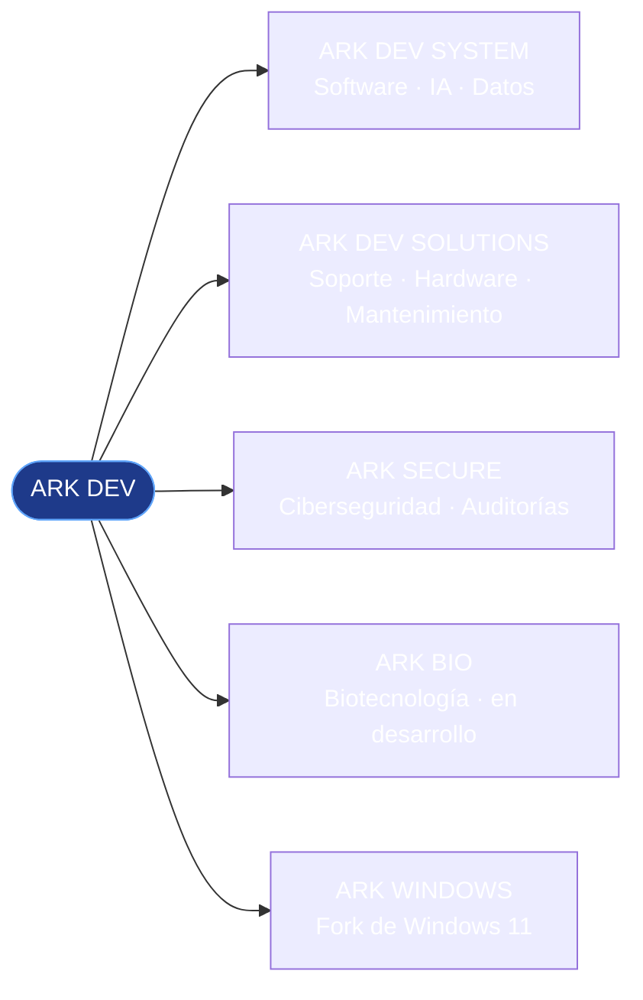

<!-- Perfil: github.com/Jhoel777ar — repositorio Jhoel777ar/Jhoel777ar, archivo README.md -->

<div align="center">


<a href="https://git.io/typing-svg"></a>

<br />

<a href="https://www.ark-dev.org"></a>
<a href="https://www.linkedin.com/in/joel-andres-c-090078345"></a>
<a href="https://www.youtube.com/@drax-jc"></a>
<a href="https://g.dev/ark_dev"></a>
<a href="mailto:ceo@ark-dev.org"></a>
<a href="https://cal.com/ark-dev"></a>

<br /><br />


<a href="https://ko-fi.com/jhoelandres"></a>

</div>

<br />

## `> whoami`

```typescript
const joel = {
  nombre   : "Joel Andrés C.",
  rol      : "Fundador & CEO @ ARK DEV",
  fundada  : "14 de abril de 2024 — Santiago, Chile",
  operando : ["Santiago, Chile", "La Paz, Bolivia"],
  formacion: "Ingeniero de Sistemas",
  enfoque  : ["Aplicaciones web con IA", "Ciberseguridad", "Software a medida"],
  canales  : { web: "ark-dev.org", youtube: "@drax-jc", youtubeEmpresa: "@ark-dev-org" },
  filosofia: "Unidos construimos más, juntos logramos lo imposible.",
};
```

Construyo aplicaciones web con IA integrada y dirijo **ARK DEV**, una consultora tecnológica con operación en Chile y Bolivia. Trabajo de punta a punta: arquitectura, backend, frontend, despliegue y seguridad.

<br />

## Ecosistema ARK DEV



<div align="center">

| División | Enfoque |
|:--|:--|
| **[ARK DEV SYSTEM](https://www.ark-dev.org/ark_dev_system.html)** | Ingeniería de software · Integración de IA · Analítica de datos |
| **[ARK DEV SOLUTIONS](https://www.ark-dev.org/ark_dev_solutions.html)** | Soporte técnico · Hardware · Mantenimiento |
| **[ARK SECURE](https://www.ark-dev.org/ark_secure.html)** | Ciberseguridad · Ethical hacking · Auditorías de seguridad |
| **[ARK BIO](https://www.ark-dev.org/ark_bio.html)** | Biotecnología · Innovación científica *(en desarrollo)* |
| **[ARK WINDOWS](https://www.ark-dev.org/ark_windows.html)** | Fork de Windows 11 orientado a usuarios técnicos |

[Docs](https://docs.ark-dev.org/) · [Newsletter](https://blog.ark-dev.org/) · [Organización en GitHub](https://github.com/ARK-DEV-ORG) · [Canal de la empresa](https://www.youtube.com/@ark-dev-org)

</div>

<br />

## Stack técnico

<div align="center">

**Frontend & UI**


**Backend & APIs**


**Datos**


**Cloud & DevOps**


**Mobile**


</div>

<details>
<summary><b>Ver detalle por área</b></summary>

<br />

| Área | Tecnologías |
|:--|:--|
| **Backend** | Laravel 11 · Livewire 3 · FilamentPHP · .NET 8 · Node.js · FastAPI · Express · NestJS |
| **Frontend** | React · Next.js 15 · Vue 3 · Nuxt · Svelte · TypeScript |
| **Animación & 3D** | GSAP · Framer Motion · Three.js · WebGL · Lottie · Rive |
| **IA** | OpenAI · Gemini · Claude · Llama 3 · Deepseek · Ollama · LangChain · LlamaIndex |
| **Infra de IA** | Pinecone · ChromaDB · Weaviate · TensorFlow · PyTorch · Scikit-learn |
| **Ciberseguridad** | Kali · Metasploit · Burp Suite · Wireshark · Nmap · Nessus · OWASP Top 10 · NIST |
| **Cloud** | AWS (SES, S3, Lambda, EC2, RDS, CloudFront) · GCP (Cloud Run, Functions, BigQuery, Vertex AI) · Azure (App Service, Functions, AI Services) |
| **Despliegue** | Hostinger VPS · Railway · Vercel · Laravel Cloud · Laravel Forge · Dockploy |
| **Tiempo real** | Pusher Channels · Socket.io · WebSockets |
| **Observabilidad & CI/CD** | Sentry · Redis · GitHub Actions · Docker Compose |
| **Multimedia** | DaVinci Resolve · After Effects · Premiere Pro · Photoshop · Illustrator · Audition |

</details>

<div align="center">


<br />


</div>

<br />

## Estadísticas de GitHub

<div align="center">

<a href="https://github.com/Jhoel777ar">
  
</a>
<a href="https://github.com/Jhoel777ar?tab=repositories">
  
</a>

<br />


</div>

<br />

## Actividad

<div align="center">

<picture>
  <source media="(prefers-color-scheme: dark)" srcset="https://raw.githubusercontent.com/Jhoel777ar/Jhoel777ar/output/github-snake-dark.svg" />
  <source media="(prefers-color-scheme: light)" srcset="https://raw.githubusercontent.com/Jhoel777ar/Jhoel777ar/output/github-snake.svg" />
  
</picture>

<br />

<picture>
  <source media="(prefers-color-scheme: dark)" srcset="https://github-readme-activity-graph.vercel.app/graph?username=Jhoel777ar&theme=react-dark&bg_color=0d1117&color=3B82F6&line=3B82F6&point=60A5FA&hide_border=true&area=true&area_color=1e3a8a" />
  
</picture>

</div>

<br />

## Plataformas con las que trabajo

<div align="center">


</div>

<br />

## Conecta conmigo

<div align="center">

[](https://www.ark-dev.org)
[](https://www.linkedin.com/in/joel-andres-c-090078345)
[](https://www.youtube.com/@drax-jc)
[](mailto:ceo@ark-dev.org)
[](https://cal.com/ark-dev)

[](https://github.com/Jhoel777ar)
[](https://www.npmjs.com/~joelandres)
[](https://stackoverflow.com/users/31984444/joel-andres-c?tab=profile)
[](https://linktr.ee/ark_dev)
[](https://app.daily.dev/joelandres)

</div>


